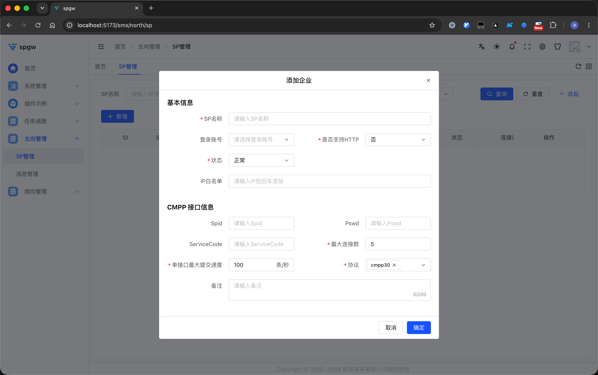
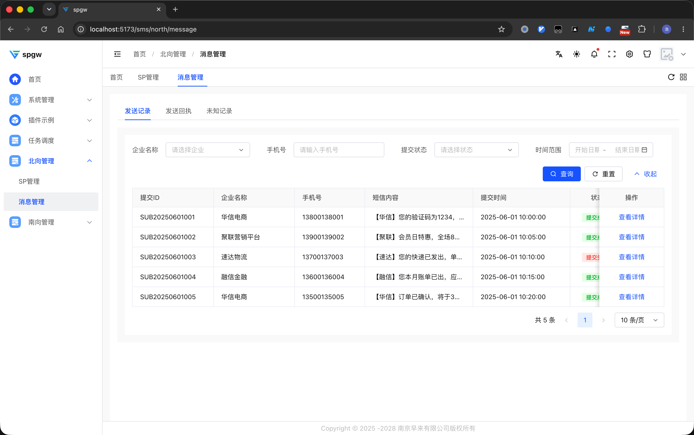
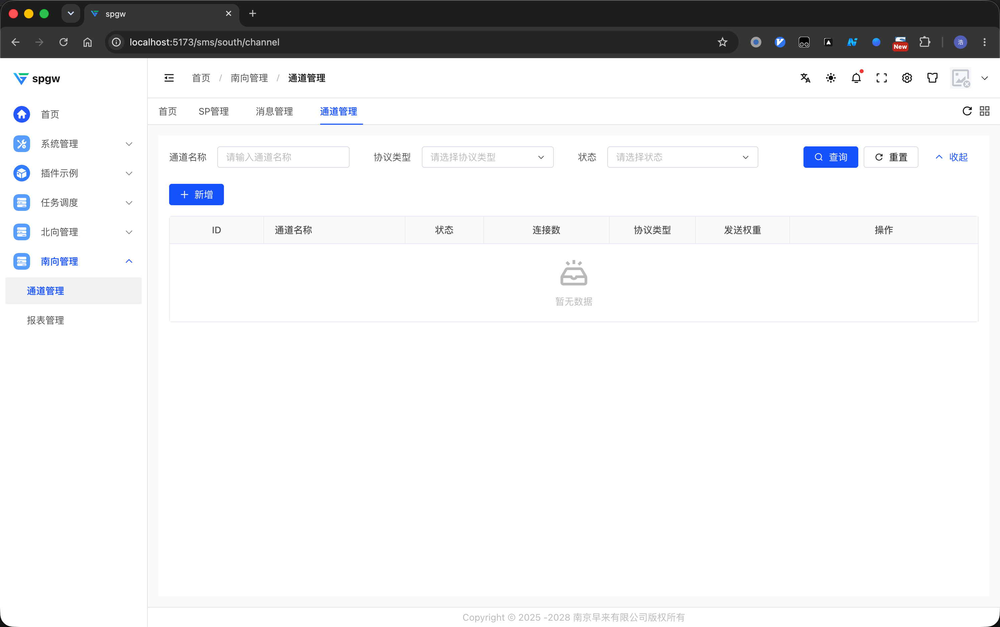
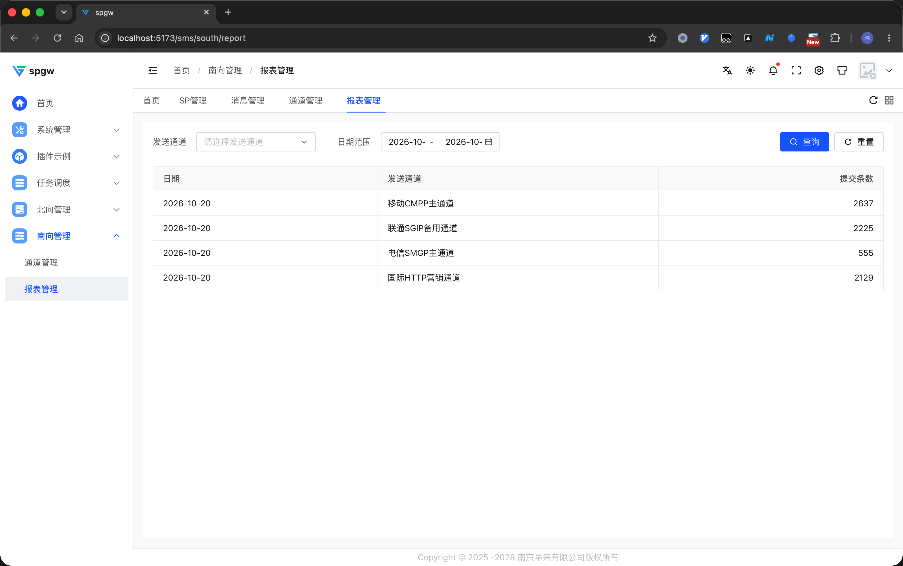

<meta name="keywords" content="短信网关,SP短信网关,短信转发,短信代理,CMPP,CMPP2.0,CMPP3.0,中国移动短信协议,ISMG,SMSC,短消息中心,短信状态报告,Delivery Report,上行短信,下行短信,MT,MO,验证码短信,通知短信,营销短信,短信通道,通道路由,HTTP短信API,Go,Golang,高并发,netpoll,NATS,etcd,MySQL,Redis,GORM,Gin,go-micro">

# spgw — SP 短信网关

简体中文 | [English](README.en.md)

spgw 是一个用 Go 语言编写的高性能 **SP 短信网关（SMS Gateway / 短信转发代理）**：面向上游 SP（Service Provider，短信息业务提供商）提供 CMPP 2.0 / CMPP 3.0 协议及 HTTP API 接入，接收其提交的短信（submit，含验证码、通知、营销等下行短信 MT），按路由与权重配置转发到下一级（南向）短信通道 / 运营商网关（ISMG），并向 SP 回传短信状态报告（Delivery Report）与上行短信（MO）。

## 功能

- 支持 CMPP 2.0 / 3.0 接收
- 支持 HTTP API 接收
- 支持 HTTP API 发送
- 支持 CMPP 2.0 / 3.0 出向（规划中）

## 界面截图

管理后台提供北向（SP 接入）与南向（下游通道）的可视化管理：

**北向管理 · SP 管理** —— SP 接入企业管理：登录账号、IP 白名单、CMPP 接口信息（Spid/Pswd、ServiceCode、最大连接数、提交速率、协议版本）



**北向管理 · 消息管理** —— 短信发送记录、发送回执与未知记录查询



**南向管理 · 通道管理** —— 下游通道的协议类型、状态与发送权重配置



**南向管理 · 报表管理** —— 按通道、按日期的提交量统计



## 为什么要使用当前系统

- 根据费率，自动选择最优通道(v0.2版本开发中)
- 根据路由，自动选择最优通道发送(v0.2版本开发中)

## 协议支持

- 北向接入（上游）
  - CMPP 2.0 接收
  - CMPP 3.0 接收
  - HTTP API 接收（`/api/sms/send`、`/api/sms/batchSend`）
- 南向出局（下游）
  - HTTP API 发送（`internal/httpsend` 适配框架 + 渠道 adapter）
  - CMPP 2.0 / 3.0 出向（规划中）

## 架构

多进程架构，进程间通过 NATS 传递业务消息，etcd 做服务发现与链路心跳，MySQL 共享元数据，Redis 提供序号断点续号与分布式锁。

| 子命令 | 职责 |
| --- | --- |
| `spgw server` | 总线消息中枢：按 CmdID 分发，路由 / HTTP 下发 / waitAck |
| `spgw iagent` | 北向 CMPP 服务端（双监听 cmpp2.0 + cmpp3.0） |
| `spgw oagent` | 南向通道客户端 |
| `spgw api` | SP HTTP API 接入（Gin） |
| `spgw cmcenter` | 控制中心（账号绑定 / 发送预算 RPC） |
| `spgw migrate` | GORM AutoMigrate（表前缀 `gw_`） |
| `spgw billdumper` | 账单导出 |

## 快速开始

依赖：Go 1.25+、MySQL、Redis、NATS、etcd（本地开发可用 `compose/` 一键起）。

```bash
# 1. 准备配置：按 config/spgw-sample.yaml 复制为根目录 config.yaml 并修改连接参数
cp config/spgw-sample.yaml config.yaml

# 2. 初始化表
MICRO_REGISTRY=etcd go run . migrate

# 3. 启动各进程（需要 MICRO_REGISTRY=etcd）
MICRO_REGISTRY=etcd go run . server
MICRO_REGISTRY=etcd go run . iagent --cmpp30port 7891 --cmpp20port 7890
MICRO_REGISTRY=etcd go run . api --port 8080
```

## 开发与构建

```bash
go build ./...
go test ./...
go vet ./...

# 修改 spgwpb/spgw.proto 后重新生成
./gen.sh

# 热重载（air）
air -c air-api.toml

# 本地 docker 构建
./run-in-docker.sh
```

## 目录结构

- `cmd/`：各子命令进程入口（server / iagent / oagent / api / cmcenter / migrate / billdumper）
- `internal/`：配置、日志、链路（CMPP Link + codec）、路由、模型、服务、下游 HTTP 发送框架等
- `spgwpb/`：跨进程消息契约（protobuf 定义与生成代码）
- `stub/`：测试桩（模拟 SP / 模拟下游 HTTP 服务）
- `scripts/`：建库 SQL、protofmt 工具
- `AGENTS.md`：仓库开发约定（代码风格、提交检查清单、协议约束说明）

## 贡献

欢迎 issue 与 PR。提交前请先阅读 [AGENTS.md](AGENTS.md) 中的提交前检查清单（build → tidy → gen.sh → build），并保证 `go test ./...`、`go vet ./...` 通过。

## 关键词

> 便于搜索引擎与 AI 检索，集中列出本项目的核心术语。

- **领域**：短信网关 / SP 短信网关 / 短信转发网关 / 短信代理 / SMS Gateway / SMSC / ISMG / 短消息中心 / 短信通道 / 通道路由 / 短信负载均衡
- **协议**：CMPP / CMPP 2.0 / CMPP 3.0 / 中国移动短信协议 / 短信状态报告（Delivery Report）/ 提交（submit）/ 应答（response）/ 上行短信（MO）/ 下行短信（MT）/ HTTP 短信 API
- **场景**：验证码短信 / 通知短信 / 营销短信 / SP 接入 / 通道管理 / 发送记录查询 / 报表统计
- **技术栈**：Go / Golang / 高并发 / netpoll / NATS / etcd / MySQL / Redis / GORM / Gin / go-micro / protobuf

## License

本项目基于 [木兰宽松许可证 第2版（Mulan PSL v2）](http://license.coscl.org.cn/MulanPSL2) 开源，详见 [LICENSE](LICENSE)。

Copyright (c) 2026 南京构播云网络科技有限公司
